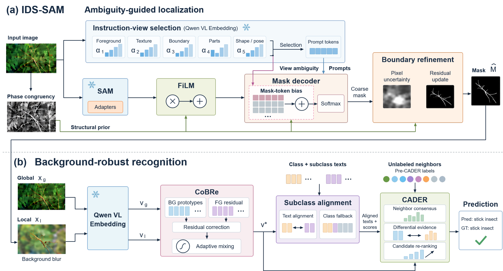
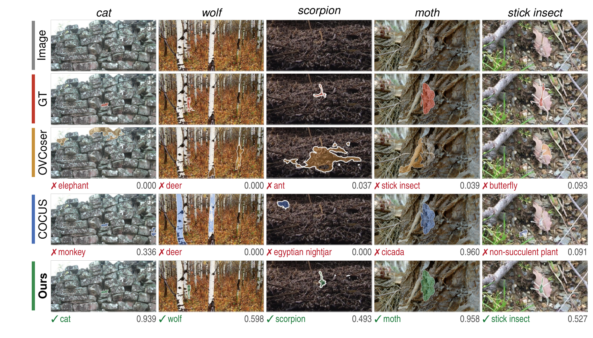

<div align="center">

<h1>IDS-SAM</h1>

<h3>Uncertainty-Guided Structural Routing and Consensus-Aware Re-Ranking<br>for Open-Vocabulary Camouflaged Object Segmentation</h3>

Jisang Lee<sup>&#42;</sup> · SeoYeon Oh<sup>&#42;</sup> · Cheoneum Park<sup>†</sup> · Haneol Jang<sup>†</sup>

Department of Computer Engineering, Hanbat National University<br>
<sup>&#42;</sup>Equal contribution · <sup>†</sup>Co-corresponding authors

**ACCV 2026**

[](LICENSE)
[](#installation)
[](#installation)

</div>

<p align="center"></p>

Open-vocabulary camouflaged object segmentation (OVCOS) fails in two coupled ways: masks leak or collapse at weak camouflage boundaries, and background-dominated embeddings leave the correct class nearly tied with distractors. We address each failure with a dedicated stage.

- **IDS-SAM** (Instruction-Driven Structure-Aware SAM) localizes the object with a frozen SAM encoder plus adapters, multi-view instruction prompts from a frozen Qwen3-VL-Embedding model, and a phase-congruency prior injected through FiLM, an ambiguity-scaled mask-token attention bias, and uncertainty-band refinement.
- **CoBRe** (Counterfactual Background Residual correction) removes background bias from global–local embedding pairs.
- **Subclass-aware alignment** sharpens candidate text embeddings with benchmark subclass descriptors.
- **CADER** (Consensus-Aware Differential Evidence Re-ranking) resolves near-ties within the fixed Top-5 candidates.

On OVCamo-Unseen the full pipeline is best on all six class-aware metrics. Against the cascaded method COCUS it raises cF<sup>ω</sup><sub>β</sub> from 0.615 to **0.691**, cIoU from 0.568 to **0.635**, lowers cMAE from 0.265 to **0.168**, and lifts Top-1 accuracy from 74.6% to **85.1%**.

## News

- **2026-10** Code released.
- **2026** Paper accepted to ACCV 2026.

## Results

OVCamo-Unseen: 3,770 images from 61 classes unseen during training. Class-aware metrics score each mask under its predicted category (Table 1).

| Method | Venue | cS<sub>m</sub> ↑ | cF<sup>ω</sup><sub>β</sub> ↑ | cMAE ↓ | cF<sub>β</sub> ↑ | cE<sub>m</sub> ↑ | cIoU ↑ |
|:--|:--|:-:|:-:|:-:|:-:|:-:|:-:|
| OVCoser | ECCV 2024 | 0.579 | 0.490 | 0.336 | 0.520 | 0.616 | 0.443 |
| Classifier-centric | ICASSP 2026 | 0.658 | 0.547 | 0.239 | 0.582 | 0.696 | 0.493 |
| SuCLIP | ICCV 2025 | 0.667 | 0.594 | 0.242 | 0.633 | 0.722 | 0.540 |
| COCUS | CVM 2026 | 0.668 | 0.615 | 0.265 | 0.631 | 0.697 | 0.568 |
| **IDS-SAM + CoBRe + CADER (ours)** | ACCV 2026 | **0.752** | **0.691** | **0.168** | **0.711** | **0.788** | **0.635** |

Recognition accuracy (%) with predicted or ground-truth masks (Table 2):

| Method | Mask | Top-1 ↑ | Top-5 ↑ |
|:--|:-:|:-:|:-:|
| COCUS | Pred | 74.62 | 90.03 |
| **Ours** | Pred | **85.12** | **93.47** |
| COCUS | GT | 78.59 | 94.97 |
| **Ours** | GT | **86.68** | **96.31** |

<details>
<summary>Recognition stages (Table 7) and qualitative results (Fig. 3)</summary>

Cumulative stages with fixed IDS-SAM masks. All stages re-rank the same fused Top-5 set, so Top-5 accuracy does not change.

| Stage | Top-1 | Top-2 | Top-3 | Top-4 | Top-5 |
|:--|:-:|:-:|:-:|:-:|:-:|
| Fused global/local baseline | 81.06 | 87.69 | 89.86 | 92.25 | 93.47 |
| + CoBRe | 81.80 | 87.74 | 90.45 | 92.36 | 93.47 |
| + Subclass alignment | 84.32 | 89.89 | 91.61 | 92.81 | 93.47 |
| + CADER | **85.12** | **90.02** | 91.56 | 92.73 | 93.47 |

<p align="center"></p>
</details>

## Installation

Tested with Python 3.10, PyTorch 2.5.1, torchvision 0.20.1 and CUDA 12.1; the paper experiments used 3 × NVIDIA RTX A6000.

```bash
git clone https://github.com/Kkubuck/IDS-SAM.git
cd IDS-SAM

conda create -n idssam python=3.10 -y
conda activate idssam
pip install torch==2.5.1 torchvision==0.20.1 --index-url https://download.pytorch.org/whl/cu121
pip install -e ".[embedding]"
```

This installs the `idssam` package and command-line tool (`idssam --help`). The `embedding` extra adds the Qwen3-VL-Embedding backend (Transformers 4.57.6).

## Data and pretrained models

1. Download [OVCamo](https://github.com/lartpang/OVCamo) to `data/ovcamo/` (14 seen classes / 7,713 training images, 61 unseen classes / 3,770 test images):

   ```text
   data/ovcamo/
   ├── dataset/{class_info.json, sample_info.json}
   └── ovcamo_dataset/{train,test}/{image,mask}/
   ```

2. Download the SAM ViT-H checkpoint [`sam_vit_h_4b8939.pth`](https://github.com/facebookresearch/segment-anything#model-checkpoints) to `checkpoints/`.
3. [Qwen3-VL-Embedding-8B](https://huggingface.co/Qwen/Qwen3-VL-Embedding-8B) is loaded by its Hugging Face ID; set `QWEN=/path/to/model` to use a local copy.

## Training and evaluation

Two scripts run the full pipeline with the paper settings:

```bash
bash scripts/train.sh   # IDS-SAM (3 GPUs, 20 epochs) -> train-set masks -> CoBRe
bash scripts/eval.sh    # OVCamo-Unseen masks -> recognition -> class-aware metrics
```

| Variable | Default | Meaning |
|:--|:--|:--|
| `OVCAMO` | `data/ovcamo` | OVCamo root |
| `SAM_CKPT` | `checkpoints/sam_vit_h_4b8939.pth` | SAM ViT-H initialization |
| `QWEN` | `Qwen/Qwen3-VL-Embedding-8B` | Embedding model ID or local path |
| `GPUS` | `3` | GPUs for IDS-SAM training (`1` disables `torchrun`) |
| `OUT` | `outputs` | Checkpoints, masks, rankings and metrics |

`eval.sh` writes class-agnostic mask metrics to `outputs/metrics/localization.json`, the class-aware OVCOS metrics of Table 1 to `outputs/metrics/ovcos.json`, and Top-1…Top-5 accuracy of each recognition stage to `outputs/recognition/test/metrics.json`.

**Protocol.** CADER is batch-transductive: each test image retrieves its 8 nearest neighbors among the other unlabeled test images and uses their predicted labels, so the reported result runs recognition on the whole test set at once. Ground-truth labels are used only for scoring. `idssam recognize --no-cader` gives the per-image path and `--no-subclass` the class-name-only setting.

[docs/GETTING_STARTED.md](docs/GETTING_STARTED.md) walks through each stage, single-GPU training, resuming, custom images and vocabularies, and the Python API. [docs/DATA_FORMATS.md](docs/DATA_FORMATS.md) specifies the manifests, caches and outputs.

## Code structure

| Paper | Code |
|:--|:--|
| Multi-view instruction prompting, residual gate mass *r* (Eqs. 1–2) | [`idssam/models/idsam.py`](idssam/models/idsam.py), [`idssam/embeddings/prompts.py`](idssam/embeddings/prompts.py) |
| Phase congruency prior (Eq. 3) | [`idssam/models/priors.py`](idssam/models/priors.py) |
| FiLM modulation and uncertainty-band refinement (Eqs. 4, 7) | [`idssam/models/layers.py`](idssam/models/layers.py), [`idssam/models/idsam.py`](idssam/models/idsam.py) |
| Ambiguity-guided mask-token attention bias (Eqs. 5–6) | [`idssam/models/sam/attention.py`](idssam/models/sam/attention.py) |
| Global–local dual-view embedding (Eq. 8) | [`idssam/data/views.py`](idssam/data/views.py), [`idssam/embeddings/extract.py`](idssam/embeddings/extract.py) |
| CoBRe and its training objective (Eq. 9) | [`idssam/recognition/cobre.py`](idssam/recognition/cobre.py), [`idssam/engine/losses.py`](idssam/engine/losses.py) |
| Subclass-aware alignment (Eq. 10) | [`idssam/recognition/subclass.py`](idssam/recognition/subclass.py) |
| CADER re-ranking (Eqs. 11–12) | [`idssam/recognition/consensus.py`](idssam/recognition/consensus.py), [`idssam/recognition/cader.py`](idssam/recognition/cader.py) |
| Class-aware OVCOS metrics | [`idssam/evaluation/`](idssam/evaluation) |

```text
IDS-SAM/
├── idssam/
│   ├── configs/        # idsam.yaml (localizer), recognition.yaml (CoBRe / CADER)
│   ├── models/         # IDS-SAM: SAM encoder/decoder, priors, FiLM, refinement
│   ├── embeddings/     # Qwen3-VL-Embedding extraction and prompts
│   ├── recognition/    # CoBRe, subclass alignment, CADER, pipeline
│   ├── engine/         # training / inference loops and losses
│   ├── data/           # manifests, datasets, mask-conditioned views
│   ├── evaluation/     # class-agnostic and class-aware metrics
│   └── cli/            # `idssam` command-line interface
├── scripts/            # train.sh, eval.sh
└── docs/               # GETTING_STARTED.md, DATA_FORMATS.md
```

## Citation

```bibtex
@inproceedings{lee2026ovcos,
  title     = {Uncertainty-Guided Structural Routing and Consensus-Aware Re-Ranking for Open-Vocabulary Camouflaged Object Segmentation},
  author    = {Lee, Jisang and Oh, SeoYeon and Park, Cheoneum and Jang, Haneol},
  booktitle = {Asian Conference on Computer Vision},
  year      = {2026}
}
```

## Acknowledgements

This code builds on [Segment Anything](https://github.com/facebookresearch/segment-anything), [SAM-Adapter](https://github.com/tianrun-chen/SAM-Adapter-PyTorch), [OVCamo](https://github.com/lartpang/OVCamo), [PySODMetrics](https://github.com/lartpang/PySODMetrics) and [Qwen3-VL-Embedding](https://github.com/QwenLM/Qwen3-VL-Embedding). We thank the authors for releasing their code.

## License

The code is released under the [Apache License 2.0](LICENSE). Upstream components keep their licenses ([THIRD_PARTY_NOTICES.md](THIRD_PARTY_NOTICES.md)). OVCamo images in the figures remain under the dataset's CC BY-NC-SA 4.0 terms.
